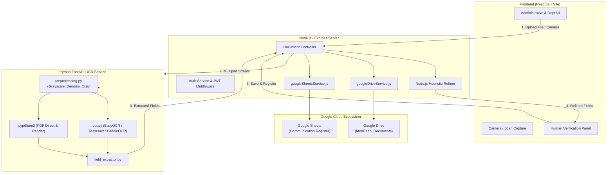
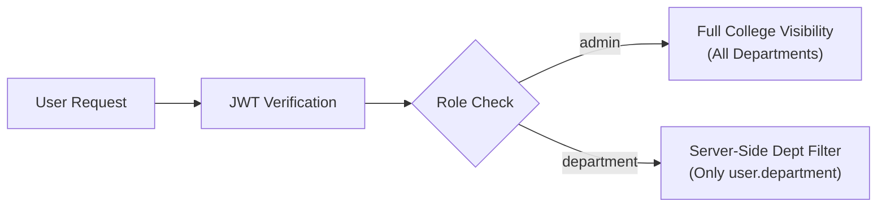

# MedDean Document Tracker - System Architecture

## 1. System Overview

**MedDean Document Tracker** is a specialized full-stack administrative correspondence tracking and pending work management system developed for a Medical College Dean's Office.

It eliminates traditional paper-register inefficiencies and fragmented manual filing by combining:
- **Optical Character Recognition (OCR)** with image preprocessing to extract Reference Numbers, Dates, Senders, and Subjects.
- **Google Drive API** as the primary unstructured document repository, organized into department folders.
- **Google Sheets API** as the single live, synchronized institutional register (1 row per communication, zero duplication).
- **Strict Server-Side Department Authorization** ensuring departments only see communications assigned to them.

---

## 2. Component Architecture



---

## 3. Google Drive Folder Structure

Google Drive is designated as the primary file repository. A configurable root folder contains dedicated subfolders for each authorized department:

```
MedDean_Documents/ (Root Folder)
├── Administration/
├── Pharmacy/
├── Medical Education/
├── Finance/
├── Human Resources/
├── Nursing/
├── Examination/
├── Research/
├── Procurement/
├── Stores/
├── Infrastructure/
├── Hospital Administration/
└── Student Affairs/
```

### File Naming Convention
Files are uploaded with deterministic, collision-free administrative names:
`{Document_ID}_{Sanitized_Reference_No}.{ext}`
Example:
`DOC-2026-00001_PH-2026-105.pdf`

---

## 4. Google Sheets Register Architecture

A single Google Spreadsheet (`MedDean_Communication_Register`) contains the live institutional log under the sheet named **`Communication Register`**.

### Column Schema (Strict Logical Order)
| Column # | Column Header | Description | Example |
|---|---|---|---|
| 1 | `Document ID` | Unique primary key (DOC-YYYY-NNNNN) | `DOC-2026-00001` |
| 2 | `Reference No` | Official letter reference number | `PH/2026/105` |
| 3 | `Communication Date` | Date on the letter (DD-MM-YYYY) | `20-09-2026` |
| 4 | `Received Date` | Date letter arrived in Dean's office | `21-09-2026` |
| 5 | `From` | Originating authority or office | `Dean Office` |
| 6 | `Subject` | Administrative topic of letter | `Annual Pharmacy Audit` |
| 7 | `Department` | Assigned medical college section | `Pharmacy` |
| 8 | `Status` | `Pending` \| `In Progress` \| `Closed` | `Pending` |
| 9 | `Remarks` | Action taken / compliance remarks | `Auditing in progress` |
| 10 | `Drive File ID` | Google Drive file unique ID | `1a2b3c4d5e...` |
| 11 | `Drive File Link` | Web viewer URL to view document | `https://drive.google.com/...` |
| 12 | `Uploaded By` | Username of administrative staff | `admin` |
| 13 | `Last Updated` | Timestamp of latest modification | `22-09-2026 14:30` |
| 14 | `Closed Date` | Date work concluded (if Closed) | `25-09-2026` |

### Data Consistency Rule
- `Document ID` is immutable.
- Status changes and remarks updates **ALWAYS UPDATE THE EXISTING ROW** in place.
- Rows are never duplicated.

---

## 5. Security & Role Isolation



- **Dean / Admin**: Unrestricted visibility across all college communications, departments, KPI summaries, and uploads.
- **Department User**: Strict server-side filtering (`WHERE department = req.user.department`). Unauthorized access to other departments returns `403 Forbidden`.
